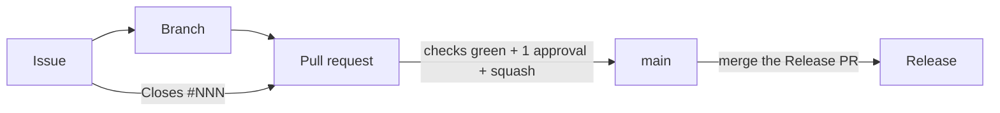

# Contributing

Nothing reaches `main` except through a pull request, and pull requests
should close the issue they resolve. Read the [README](README.md) for the stack itself, and follow
the [Code of Conduct](CODE_OF_CONDUCT.md).

## Setup

1. Install [Nix](https://install.determinate.systems/) with flakes, then run
   `nix develop` (or `direnv allow`) in the repo. It puts every tool on
   `PATH`, creates `.env`, fills `change-me-*` secrets and enables the git
   hooks.
2. Set up commit signing once (see [Branches and commits](#2-branches-and-commits)):
   the `commit-msg` hook rejects unsigned commits.
3. `just install`, then `just dev` to run the desktop app and the Expo
   server together. Work on one app with `just desktop-dev` or
   `just mobile-start`. The first time you enter the shell in a terminal, it
   installs the Android SDK for mobile builds and asks you to accept Google's
   licences; set `ANDROID_SDK_INSTALL=0` in `.env` to skip that.
4. Before every push, run `just ci`: the desktop lint/type-check/build and
   `cargo fmt`/`clippy`/`test`, the mobile lint and type-check, and the
   workflow lint. These are the same checks CI runs.

Without Nix: `cp .env.example .env`, install `just`, Node.js 24, Rust and the
[Tauri prerequisites](https://tauri.app/start/prerequisites/), and run
`git config core.hooksPath .githooks`. The [README](README.md#requirements)
lists the details.

## Where things live

| Path | What |
| ---- | ---- |
| `desktop/src/` | desktop frontend (React + Vite + Tailwind + shadcn/ui) |
| `desktop/src-tauri/` | desktop backend (Rust); `#[tauri::command]` functions are called from React with `invoke` |
| `mobile/` | Android app (Expo / React Native + NativeWind); `app.json` configures it, `android/` is generated and git-ignored |
| `nix/`, `flake.nix` | the dev shell, one pinned tool per file |
| `.github/workflows/` | CI, releases, SAST, Scorecard |

## The chain



### 1. Issues

- Open issues through one of the four forms (Feature, Bug, R&D, Debt); blank
  issues are disabled. Each form adds its type label and `needs-triage`.
- **Never** report a vulnerability in a public issue; use the private
  security advisory linked from the *New issue* page.
- `openssf` and `auto-update` labels are set by workflows, not by hand. When
  you add a label, describe it and list it here.

### 2. Branches and commits

- Branch from `main` (`feat/add-settings-page`, `42-fix-window-crash`). No direct pushes
  to `main`; rebase rather than merging `main` in.
- Commits and PR titles are [Conventional Commits](https://www.conventionalcommits.org/en/v1.0.0/#summary):
  `<type>[(scope)][!]: description`, lower-case description, no trailing
  period (for example `feat(mobile): add a settings screen`; scopes in use are
  `desktop`, `mobile`, `ci`, `nix`, `docs`). Types: `feat fix docs style refactor perf test build ci chore revert`.
  [Cheatsheet](https://gist.github.com/qoomon/5dfcdf8eec66a051ecd85625518cfd13#commit-message-formats).
- The type sets the next version: `fix` → patch, `feat` → minor, `!` or a
  `BREAKING CHANGE:` footer → major; other types don't release.
- Commits must be **signed off** (`git commit -s`) and **signed**. One-time
  SSH signing setup, then add the key on GitHub as a *Signing Key*
  ([docs](https://docs.github.com/en/authentication/managing-commit-signature-verification/about-commit-signature-verification)):

  ```bash
  git config --global gpg.format ssh
  git config --global user.signingkey ~/.ssh/id_ed25519.pub
  git config --global commit.gpgsign true
  ```

The `commit-msg` hook checks all of this locally (opt out of the signing part
with `git config hooks.requireSignature false`). It is only feedback —
`--no-verify` skips it; CI and the ruleset are the real gate. The type list
lives in both `.githooks/check-conventional-commit-msg` and
`check-conventional-commit-pr-title.yml`; keep them identical.

### 3. Pull requests

- Fill in the template and link the issue with `Closes #NNN`. The PR title
  becomes the squash commit on `main`.
- 1 approval (plus code owners where set) and every thread resolved.
- The ruleset requires a single check, `ci-required`, on a branch up to date
  with `main`. It aggregates the `ci.yml` jobs below; `conventional-title`
  runs too but is advisory.

| Check | Enforces | Reproduce locally |
| ----- | -------- | ----------------- |
| `conventional-title` (advisory) | PR title (and a lone commit) is a Conventional Commit | — edit the title, it re-runs |
| `ci-required` ← `devshell` | the flake evaluates | `nix flake check --no-build` |
| `ci-required` ← `node` (desktop, mobile) | each app lints, type-checks and builds | `just desktop-check`, `just mobile-check` |
| `ci-required` ← `desktop-rust` | the Tauri crate is formatted, clippy-clean and tested | `just desktop-check` |
| `ci-required` ← `workflow-lint`, `zizmor` | workflows lint clean and pass the security audit | `just lint-workflows` |
| `ci-required` ← `dependencies-audit` | no Critical/High and fewer than 5 Moderate+Low advisories | bump the dependency |
| `ci-sast-required` (opt-in) | no CodeQL error; SonarQube gate passes | see [`.sast/README.md`](.sast/README.md) |

Before opening: issue linked, PR title a Conventional Commit, branch rebased, `just lint-workflows` run if you
touched `.github/`, tests and docs updated, AI-assisted changes reviewed line
by line.

### 4. Releases

Never by hand. release-please keeps a Release PR open with the next version
and changelog; merging it tags the release (no `v` prefix), and
`release-to-installer.yml` builds `DokKodi-Desktop-linux-amd64.deb`,
`DokKodi-Desktop-windows-x64.msi` and `DokKodi-Remote-android-universal.apk`
and attaches them to the release.

## Tools in the dev shell

`just`, Node.js (`npm`, `npx`), the Rust toolchain (`cargo`, `clippy`,
`rustfmt`, all official binaries), a Temurin JDK 17 for Gradle, the Android
command-line tools (`sdkmanager`), the Tauri system libraries on Linux,
`actionlint` + `shellcheck`, `zizmor` (same version as CI),
`check-jsonschema`, `pin-github-action` (pins `uses:` to commit SHAs) and
`jq`. The Android SDK itself is not packaged: the shell installs it into
`ANDROID_HOME` on the first interactive entry.

## Troubleshooting

Record every incident under [`docs/troubleshooting/`](docs/troubleshooting/),
in a subfolder per area, one Markdown file per incident:

```
docs/troubleshooting/
├── desktop/webkit2gtk-missing-on-linux.md
├── mobile/gradle-cannot-find-android-sdk.md
└── ci/desktop-rust-job-timeout.md
```

Each file names the **Error** (what was observed), its **Occurrences**
(dates, environment), the **Cause** and the **Solution**, written for someone
who wasn't there. Same cause as an existing entry? Add an occurrence to it
instead of a new file; link related entries by relative path. Example:

```markdown
# Gradle cannot find the Android SDK

**Error:** `just mobile-apk` fails with `SDK location not found`.

**Occurrences:** 2026-01-01 (Linux, SDK installed by Android Studio).

**Cause:** `ANDROID_HOME` is unset and the SDK is not in `~/Android/Sdk`.

**Solution:** set `ANDROID_HOME` in `.env` to the SDK directory.
```
