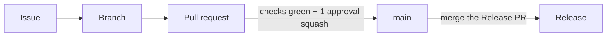

# Contributing

Nothing reaches `main` except through a pull request that closes an issue.
Read the [README](README.md) for the stack and follow the
[Code of Conduct](CODE_OF_CONDUCT.md).

## Quick start

1. Install [Nix](https://install.determinate.systems/) with flakes and run
   `nix develop` (or `direnv allow`). It provides every tool, creates `.env`
   and enables the git hooks.
2. Set up commit signing once ([how](#2-branch-and-commits)).
3. `just install`, then `just dev` to run the desktop app and the Expo server
   together (`just desktop-dev` or `just mobile-start` for one of them).
   The first interactive `nix develop` also offers to install the Android SDK
   for mobile builds; answer `n` or set `ANDROID_SDK_INSTALL=0` in `.env` to
   skip it.
4. Before every push, run `just ci`. It runs the same checks as CI.

No Nix? See [Requirements](README.md#requirements) in the README.

| Where | What |
| ----- | ---- |
| `desktop/src/` | desktop frontend (React, Vite, Tailwind, shadcn/ui) |
| `desktop/src-tauri/` | desktop backend (Rust); `#[tauri::command]` functions are called from React with `invoke` |
| `mobile/` | Android app (Expo, React Native, NativeWind) |
| `nix/`, `flake.nix` | the dev shell, one pinned tool per file |
| `.github/workflows/` | CI, releases, security scans |

## From idea to release



### 1. Issue

Open one with a form (Feature, Bug, R&D or Debt). To report a vulnerability,
use the private security advisory linked from the *New issue* page, never a
public issue.

### 2. Branch and commits

- Branch from `main` (`feat/add-settings-page`, `42-fix-window-crash`); never
  push to `main`, and rebase rather than merge `main` in.
- Commit messages and PR titles are
  [Conventional Commits](https://www.conventionalcommits.org/en/v1.0.0/#summary):
  `<type>[(scope)][!]: description`, lower-case, no trailing period, for
  example `feat(mobile): add a settings screen`. Types: `feat fix docs style
  refactor perf test build ci chore revert`; scopes: `desktop`, `mobile`,
  `ci`, `nix`, `docs`.
- The type sets the next version: `fix` is a patch, `feat` a minor, `!` or a
  `BREAKING CHANGE:` footer a major. Other types don't release.

- Commits must be **signed off** (`git commit -s`) and **signed**. One-time SSH
  signing setup, then add the key on GitHub as a *Signing Key*
  ([docs](https://docs.github.com/en/authentication/managing-commit-signature-verification/about-commit-signature-verification)):

  ```bash
  git config --global gpg.format ssh
  git config --global user.signingkey ~/.ssh/id_ed25519.pub
  git config --global commit.gpgsign true
  ```

The `commit-msg` hook checks all of this locally. It is only feedback; CI and
the branch ruleset are the real gate. Opt out of the signature check with
`git config hooks.requireSignature false`.

### 3. Pull request

- Fill in the template and link the issue with `Closes #NNN`. The PR title
  becomes the squash commit on `main`.
- It needs 1 approval, every thread resolved, and the single required check
  `ci-required` green on a branch up to date with `main`.

**Reading the CI feedback.** Open the run's **Summary** page (the *Details*
link on a check, then *Summary*). Every job writes a short result there, so
you don't need the logs to see what happened:

- **Which jobs run** lists what the PR touched and what was skipped.
- Each job has a one-line verdict (✅ passed, ❌ failed, ⚪ skipped); the
  test jobs add their test counts and coverage.
- **CI result** is the table behind `ci-required`.

Only jobs whose files changed run on a PR; `ci-required` accepts a skip but
never a failure. A change to `ci.yml`, a push to `main` and a manual run check
everything.

| Job | Runs when the PR touches | Reproduce locally |
| --- | ------------------------ | ----------------- |
| `node` (desktop) | `desktop/` outside `src-tauri/` | `just desktop-check` |
| `node` (mobile) | `mobile/` | `just mobile-check` |
| `desktop-rust` | `desktop/src-tauri/` or any `*.rs` | `just desktop-check` |
| `devshell` | `flake.nix`, `flake.lock`, `nix/`, `justfile`, `.env.example` | `nix flake check --no-build` |
| `workflow-lint`, `zizmor` | `.github/` | `just lint-workflows` |
| `dependencies-audit` | a `package-lock.json` or `Cargo.lock` | bump the dependency |

Also on every PR: `conventional-title` (advisory: is the title a Conventional
Commit?), and the opt-in `ci-sast-required` (CodeQL, SonarQube; see
[`.sast/README.md`](.sast/README.md)).

Before opening: issue linked, title a Conventional Commit, branch rebased,
`just ci` green, tests and docs updated, AI-assisted changes reviewed line by
line.

### 4. Release

Never by hand. release-please keeps a Release PR open with the next version
and changelog; merging it tags the release, and `release-to-installer.yml`
attaches `DokKodi-Desktop-linux-amd64.deb`, `DokKodi-Desktop-windows-x64.msi`
and `DokKodi-Remote-android-universal.apk` to it.

## Troubleshooting

Hit a problem and solved it? Add a Markdown file under
[`docs/troubleshooting/`](docs/troubleshooting/), in a subfolder per area,
with the **Error** (what you saw), **Occurrences** (dates, environment),
**Cause** and **Solution**, written for someone who wasn't there. Same cause
as an existing entry? Add an occurrence to it instead. See
[`nix/disk-space.md`](docs/troubleshooting/nix/disk-space.md) for an example.
